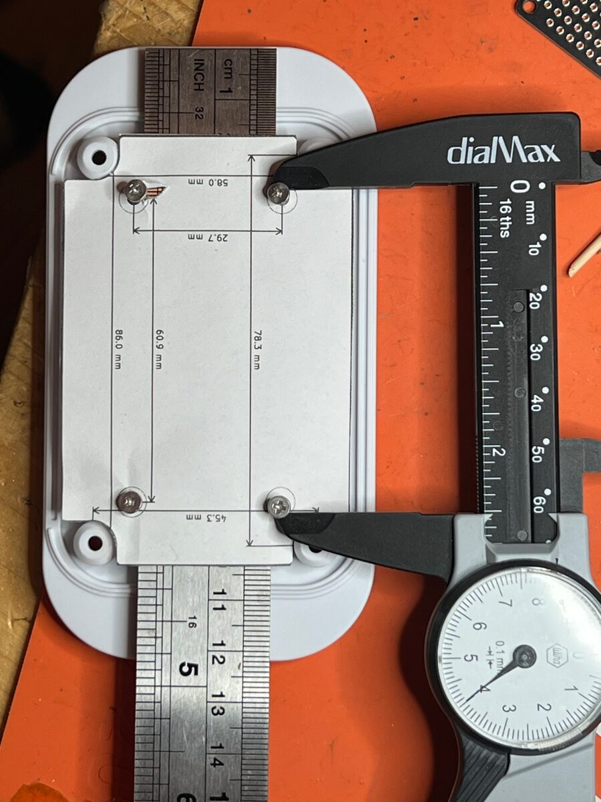
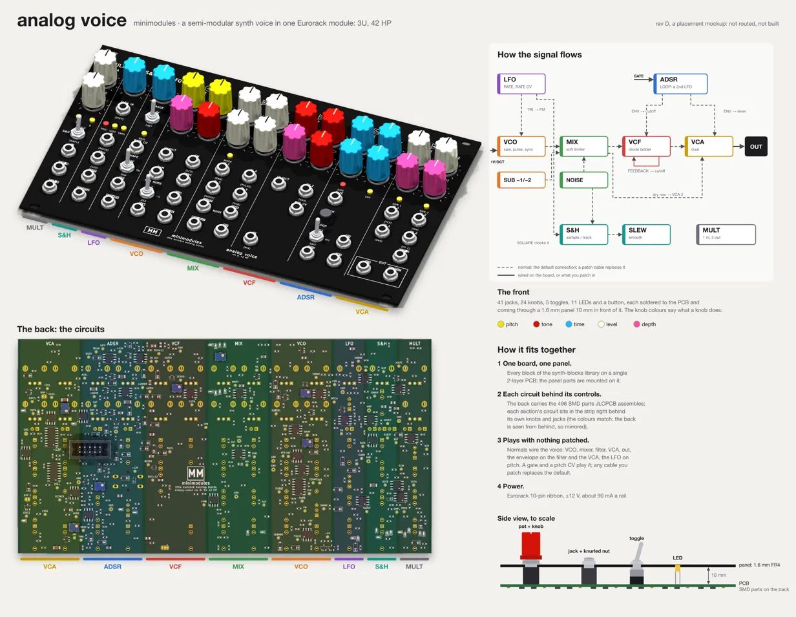

# pcb-kit

KiCad tooling and agent skills for designing, checking and ordering circuit boards with Claude Code. It started as
the scripts that every board in the somebox hardware projects ended up copying (DRC summaries, fab files, previews, a
schematic builder) and grew into a way of working with an agent on a board: describe the design in text, check it
with scripts, and look at pictures of it along the way.

The kit holds the engine; each project keeps its own data. Placement tables, net lists, power-stage geometry and
design notes stay in the board's repo and call `pcbkit`.

Three parts:

- **`pcbkit`**, a Python package and CLI: checks, release files, enclosure outlines, EasyEDA import, net views,
  placement scoring, a maze router, simulation runs, a schematic builder for konnect.
- **`skills/`**, agent skills in SKILL.md form, used by Claude Code and pi.
- **`templates/`** and **`library/`**: the project skeleton, conventions and trusted parts.

## What you need

The skills have the agent run tools on your machine, so they do their work in Claude Code or pi on a Mac that has:

- KiCad 10 in `/Applications/KiCad/KiCad.app`, or wherever `PCBKIT_KICAD_APP` points. `pcbkit` uses the app
  bundle's `kicad-cli` and Python, so it runs on macOS only.
- The `pcbkit` CLI, installed with uv from a clone of this repository; see [Install](#install).
- For some of the work: [konnect](https://github.com/mixelpixx/Konnect) (schematic sheets, the JLCPCB parts cache),
  [bomi](https://github.com/somebox/bomi) (BOM, stock, prices, datasheets), ngspice (power simulation), and librsvg,
  poppler and ImageMagick (pictures and prints).

In claude.ai chat and Cowork the skills load, but those sessions have none of these tools, so there the skills can
only describe the steps.

## Using it from an agent

- **Claude Code:** the repo is its own plugin marketplace. Add it one of three ways, then
  `claude plugin install pcb-kit@pcb-kit`; the skills are `/pcb-kit:failure-review` and so on. Marketplace names are
  unique, so a machine has one of the three, not two.
  - `claude plugin marketplace add somebox/pcb-kit#v0.3.0` installs that release and stays on it. To move to a later
    one, `claude plugin marketplace remove pcb-kit`, then add and install again with the new tag.
  - `claude plugin marketplace add somebox/pcb-kit` follows `main`. A fresh install takes `main` as it is, which can
    include commits not released yet under the current version number. Claude Code keeps one copy per version, so
    `claude plugin update` changes it only when `plugin.json`'s version does, which is at each release's bump.
  - `claude plugin marketplace add ~/src/pcb-kit`, for working on the skills: the checkout loads in place, and edits
    apply after `/reload-plugins`.
- **pi:** `pi install /path-to/pcb-kit` (the `package.json` here declares the skills), or `pi --skill /path-to/pcb-kit/skills/pcb-kit`.
- **KiCad:** nothing to install; the commands drive `kicad-cli` and KiCad's Python, and konnect (the KiCad MCP server) is
  used from both agents and `pcbkit.schematic`.

## What it does

### Start or import a project

`pcbkit new` scaffolds a hardware repo: README, DESIGN, LAYOUT and PRODUCTION documents with status lines, an empty
KiCad project with library tables, `scripts/`, a bomi project and a first commit. `pcbkit import-easyeda` brings an
EasyEDA Std schematic and PCB across with symbols and footprints into the project library and runs ERC, DRC and
parity on the result. It converts every sheet, and a rerun writes the same library footprints, so an import can be
repeated. The esp32-ha-protoboard was converted this way, and esp32-s3-ha-node was started with `new`.

### Fit a board to a box

Measure the enclosure (drawing, calipers, or a photo against a ruler), write the numbers into an `enclosure.json`,
and `pcbkit outline` draws the board outline with notches around the lid bosses, the mounting holes with their
standoff rings (and a keep-out under the screw head when the screws go in from the top), keep-outs, and the box's
walls for reference. `--fit-check` exports a 1:1 PDF with dimension lines and a scale bar to print, cut out and
screw into the box. `--parts` adds the placed parts, for a last check of the connectors against the walls.

The print, and one cut out and screwed onto its box's standoffs, with calipers checking the hole spacing against the
dimension lines:

 

### See how dense a board gets before drawing the schematic

A placement mock-up drops stock footprints for the proposed parts onto the outline, grouped by block, without nets.
A 3-D render then shows how full the board is, which edges the connectors need, and what the alternatives look
like, such as three terminal-block pitches. The esp32-s3-ha-node layout was settled over several rounds of this, before any schematic existed.


### Show the whole design on one page

For someone new to a design, one sheet can carry it: renders of both sides next to a block diagram, each block in
the same colour in all of them. synth-blocks' analog voice, a semi-modular Eurorack voice, has one at its
placement mock-up stage: the front panel in three-quarter view with each section marked along its edge, the back of
the PCB with each section's strip tinted, the signal flow with its normalled connections, the knob colours, and a
to-scale side view of the panel stack. Its `scripts/overview.py` renders the views with `kicad-cli`, composes them in
an SVG and rasterises it with `rsvg-convert`; the visual-review skill has the recipe.



### Place by the ratsnest, route the winner

A full route of a dense board can take most of an hour; a ratsnest score takes milliseconds. `pcbkit place-score`
counts crossings between nets' ratsnest edges (only where they could meet on one layer), their length, courtyard
area over zones to keep clear (such as where the other side's vias will go), and solves free choices like which
register output drives which gate. With a study file it moves groups of parts through their candidate positions and
keeps the best; `--svg` draws the ratsnest with the crossings circled. Only the winner gets routed: on Orbitchron's
driver board the first scored placement cut the full route's unconnected items from 7 to 3.

### Route from a script

`pcbkit.route` is a maze router for a project's routing script. `complete_nets` takes a plan of net patterns, layers
and widths and joins each net's copper islands one at a time, with A* on a 0.1 mm grid across the copper layers:
vias where they clear, narrower track onto small pins, and every route ending on a pad centre. Pads are obstacles
by their real shape on each layer they reach, so the pins of a chip set at an angle stay reachable; modelling them
that way took Orbitchron's driver from 8 routed connections on its two angled chips to 46. A connection that can't
be found otherwise spends its whole search budget, so `CONN_SECONDS` caps each one and `DEADLINE` the whole run,
and what is left is reported for hand routing. Around it: GND stitching, plane and escape vias, neck-down, snapping
other routes' ends to pad centres, and an audit of every track end. esp32-s3-ha-node's `scripts/route_pcb.py`
routes its power nets and most signals this way in a run capped at 15 minutes; the rest was finished by hand.
`pcbkit cleanup --dangling` then removes the dead ends a route leaves.

### Look at the copper

`pcbkit netview` draws one layer of a board region with every net in its own colour, pads labelled and courtyards
dashed. It is the fastest way to review a power stage against the datasheet's layout guidance, or to see which net
a stray pour belongs to.


When a check flags something small, a tight raster of the layer with the flagged items marked shows what it
actually refers to before anything gets edited:


### Check a board

`pcbkit drc`, `erc` and `nets` wrap `kicad-cli` and summarise by type, net and footprint. `pcbkit check` finds what
DRC doesn't: floating copper, stubs, loops, pours that reach a single pad, power pads fed only through thin track.
`pcbkit cleanup` removes duplicate and zero-length segments by editing the file text, because pcbnew's own
`Remove()` corrupts its bindings mid-run; `--dangling` also peels a router's dead ends, one leaf at a time, so no
net is ever split. Before an order, KiCadRoutingTools' checkers give a second opinion.

### Simulate the power path

`pcbkit spice` runs an ngspice deck with PSpice compatibility on, which vendor models need, and returns its
measurements. It reports a run as aborted when ngspice gives up, because a failed run still prints zeros. The
dodeca control board used this to size a boost converter's load-step margin and to find a supply-mux case where a
firmware test would have given the wrong answer, which changed the part. siebenuhr's controller
followed the same approach for its LED converter. The plot below shows its averaged TPS55288 buck-boost model, with
LED rail voltage and inductor current through load steps, an overload and start-up.


### Find what could fail before ordering

The failure-review skill checks each block against its datasheets, the vendor's reference design and what earlier
boards taught, lists what could go wrong once the boards are back, with how each failure would show up on the
bench and how to tell it from the others, and settles the doubtful ones by calculation or simulation. It plans test
points, 0 Ω links and DNP options for the measurements and rework a finding might need, and ends with a briefing for
the user to decide from before anything is changed. Its examples are the dodeca v1.3 power review, where a
simulation caught a test that would have misread good boards, and siebenuhr's analysis of a controller that failed
in the field.

### Know what the board costs

bomi keeps the BOM in sync with the schematic and refreshes stock and price from JLC/LCSC; `pcbkit jlc` searches
the local parts cache for quick look-ups. A project's BOM.md lists the cost drivers, the Extended-part fees per
order, the cheap swaps, and any part whose stock is low enough to worry about.


### Reuse parts that worked

[library/PARTS.md](library/PARTS.md) collects the ICs and drivers that have been on built boards, with the circuit
notes that made them work and the ones that went wrong: level shifters that isolate an unpowered rail versus ones that
back-power it, LED drivers that need only a resistor, the USB-PD sink whose 5 V contract couldn't carry a clock's LEDs.
`pcbkit parts` lists the catalog with current stock and price from the parts cache and flags anything that has run low.
Two of the proven parts show zero stock in the 2026-09-29 cache, which is the reason to check when a design starts.

### Order it

`pcbkit previews` makes the schematic PDF, copper PNGs, a hand-assembly map, a 1:1 print and 3-D renders.
`pcbkit fab` writes the JLC Gerber zip, BOM and CPL with rotation corrections, and with `--houses jlcpcb,pcbway`
PCBWay's BOM (manufacturer and part number) and centroid too. `pcbkit panel` builds KiKit assembly panels with rails,
fiducials and tooling holes, and runs DRC on each.

`pcbkit release` is the step before an order. It checks every board, and gives each one that changed since its last
release the next version (a fix to v1.0 makes v1.0.1), stamped into the title block and the silkscreen, so the KiCad
file always says which version it is. That version's Gerbers, BOMs, placement files and PDFs go into a committed
release folder. A KiCad save that only reshuffles the file, or a schematic note, doesn't count as a change: only a
different fab output does. `pcbkit production` keeps one overview in PRODUCTION.md: every board's version, the orders
in production with their state, order numbers and prices, parts costs, boards and parts in stock, and what is short.
Orders and stock are small TOML files that you or an agent edit as things happen. A project's `pcbkit.toml` says
where everything goes and can turn either feature off.

## Skills

| Skill | Use it for |
| --- | --- |
| [pcb-kit](skills/pcb-kit/SKILL.md) | the command map, the project rules, KiCad Python gotchas |
| [visual-review](skills/visual-review/SKILL.md) | which picture answers which question, and how to read it before drawing conclusions |
| [enclosure-fit](skills/enclosure-fit/SKILL.md) | measuring a box, the outline JSON, the print-and-cut loop and what went wrong in it |
| [power-sim](skills/power-sim/SKILL.md) | one ngspice script per design question; averaged models when vendor models stall |
| [bom-cost](skills/bom-cost/SKILL.md) | the proven-parts catalog first, then bomi: stock checks, Extended-part fees, what goes into BOM.md |
| [placement-study](skills/placement-study/SKILL.md) | scoring placements by their ratsnest, the study file, searching, and routing only the winner |
| [failure-review](skills/failure-review/SKILL.md) | before an order: datasheets and reference designs, failure modes and how to diagnose them, test points, a briefing before any change |

[docs/CONVENTIONS.md](docs/CONVENTIONS.md) is the project layout and writing style they all assume: dated status
lines, numbered decisions, generated files that say what made them.

## Tools it builds on

| Tool | Role |
| --- | --- |
| KiCad 10 (`kicad-cli`, pcbnew Python) | the design files, DRC/ERC, exports, renders |
| konnect | KiCad MCP server; `pcbkit.schematic` writes schematic sheets through it, and its JLCPCB cache backs `pcbkit jlc` |
| bomi | BOM, stock, prices, datasheet summaries |
| ngspice 47 | power-path simulation (`brew install ngspice`) |
| KiKit | panels, pinned to a known commit by `pcbkit setup-kikit` |
| KiCadRoutingTools | routing on siebenuhr, and a second set of checkers before every order |
| librsvg, poppler, ImageMagick | SVG to PNG, PDF crops and merges |

## Install

```bash
git clone https://github.com/somebox/pcb-kit ~/src/pcb-kit
uv tool install -e ~/src/pcb-kit     # gives you `pcbkit`
pcbkit info                          # confirms where KiCad is
pcbkit setup-kikit                   # only for panels: pins KiKit into ~/.local/share/pcbkit
pcbkit link                          # lets project scripts `import pcbkit` under KiCad's Python and python3
```

`link` writes one `pcbkit.pth` into the user site-packages of KiCad's Python and of the `python3` on PATH, so nothing
goes into an app bundle and it survives upgrades; `pcbkit link --remove` undoes it. Because `python3` can differ per
directory (asdf, direnv, venvs), project scripts also carry a four-line fallback to `~/src/pcb-kit` (or `PCBKIT_ROOT`);
see docs/CONVENTIONS.md.

Two interpreters are involved. `pcbkit` runs in uv's Python; the commands that need `pcbnew` re-execute themselves
under KiCad's bundled Python (3.9 on macOS), so the package code stays 3.9-compatible and dependency-free. Set
`PCBKIT_KICAD_APP` if KiCad is not at `/Applications/KiCad/KiCad.app`. Previews need `rsvg-convert` (librsvg),
`pdfunite` (poppler) and optionally `magick` (ImageMagick); `pcbkit spice` needs `ngspice`.

## What it runs and sends

The plugin is skills only: no hooks, MCP servers or scripts run when it is installed or loaded. The skills tell the
agent which commands to run, under Claude Code's usual permission prompts:

- `pcbkit` and `kicad-cli` read and write the project's files on your machine. `pcbkit` makes no network requests
  apart from `setup-kikit`, which installs KiKit with pip from GitHub at a pinned commit. `pcbkit new` makes a local
  git repository with a first commit and pushes nothing.
- konnect runs as an MCP server for schematic work. Its `download_jlcpcb_database` tool downloads the JLCPCB parts
  database (from bouni/kicad-jlcpcb-tools) into `~/.konnect/`, and `pcbkit jlc` and `pcbkit parts` read that copy
  offline.
- bomi looks parts up on jlcpcb.com (stock, price, details) and downloads datasheet PDFs from lcsc.com. Its
  datasheet summaries, which the failure-review skill asks for, send the datasheet to OpenRouter with the key you
  set up in bomi; without a key, read the PDF instead.
- The failure-review skill has the agent search the web for datasheets, reference designs, application notes, open
  designs using a part and vendor forums. Power-sim projects download vendors' SPICE models with a script of their
  own.

## Commands

| Command | What it does |
| --- | --- |
| `pcbkit drc BOARD [--refill] [--save] [--full]` | DRC through kicad-cli: counts by type, every error, unconnected items by net and footprint. `--save` refills and writes the board back, which is how the projects keep their boards filled. Exit 1 on errors or unconnected items |
| `pcbkit erc SCH` | ERC summary, exit 1 on errors |
| `pcbkit nets SCH [NET ...]` | net sizes and members; `pcbkit.checks.netlist.Netlist` is the base for a project's topology assertions |
| `pcbkit check BOARD` | what DRC doesn't flag: floating copper, stubs with their full length, loops, pours reaching one pad, power pads fed only through thin track |
| `pcbkit cleanup BOARD [--dry-run] [--dangling]` | duplicate, zero-length and covered segments removed, collinear runs merged; `--dangling` also removes dead-end segments that no net needs; edits the file text by uuid |
| `pcbkit previews BOARD OUT` | schematic PDF, copper PNGs front and back, hand-assembly map, 1:1 printable PDF, plane views on 4-layer boards, 3-D renders |
| `pcbkit print BOARD OUT.pdf` | the 1:1 printable PDF alone |
| `pcbkit fab BOARD OUT [--houses jlcpcb,pcbway] [--placed field:NAME=VALUE] [--no-assembly] [--extra-layers L,..] [--name N]` | JLC Gerber zip, BOM (one row per LCSC number) and CPL (front-only and both-sides variants), rotations corrected from the kicad-jlcpcb-tools table; PCBWay's BOM and centroid with `pcbway` |
| `pcbkit release [PCB ..] [--minor\|--major] [--version X.Y.Z] [--dry-run]` | every board per `pcbkit.toml`: checks; a new version for each changed one (patch by default), stamped into its KiCad files; its fab files, PDFs and previews in its release folder; then `pcbkit production` |
| `pcbkit production [--check]` | PRODUCTION.md's overview from the releases, `production/orders/*/order.toml` and `production/stock.toml`; each order's ORDER.md and upload folder; `--check` exits 1 on problems |
| `pcbkit panel BOARD OUT [--style vcut\|mousebite\|both] [--rows 3] [--previews DIR] [--hide-refs REGEX]` | KiKit assembly panels with rails, tooling holes, fiducials, order-number placeholder, unique per-copy references; DRC on each |
| `pcbkit jlc --lcsc C25744` | SQL search over konnect's JLCPCB parts cache |
| `pcbkit parts [TEXT] [--low N]` | the proven-parts catalog (library/PARTS.md) with current stock and price; flags low stock |
| `pcbkit netview BOARD OUT.svg X0 Y0 X1 Y1 [--layer] [--png]` | a region of one layer coloured by net, for reviewing power stages |
| `pcbkit place-score BOARD [--study S.py] [--planes GND,..] [--search] [--write P.json] [--svg OUT.svg] [--png]` | ratsnest score of a placement (side-aware crossings, length, zones, free pin/gate choices); with a study, coordinate descent over groups of parts; the ratsnest picture |
| `pcbkit spice DECK.cir [--vendor DIR] [--gear-retry] [--keep DIR]` | ngspice with PSpice compatibility in a scratch directory; prints `.meas` values and `wrdata` files, exit 1 when the run aborted |
| `pcbkit new DIR --board NAME [--title ..] [--description ..]` | scaffold a project: README/DESIGN/LAYOUT/PRODUCTION from the templates, `boards/NAME/` empty KiCad project with lib tables, `lib/`, `scripts/` (previews, fab, builder glue), bomi, first git commit |
| `pcbkit outline BOARD enclosure.json [--fit-check PDF] [--parts]` | board outline (rounded, notched or cut around bosses), NPTH mounting holes with standoff courtyards (and a screw-head keep-out with `"head"`), keep-out rule areas over bosses, reference geometry and notes, from a JSON measured off the enclosure; rerunnable. `--fit-check` adds the 1:1 print, `--parts` the placed parts on it |
| `pcbkit import-easyeda SCH.json PCB.json boards/<b> --name <b> --lib lib --lib-name <project> [--pin REF:NAME=NUM]` | EasyEDA Std exports to a linked KiCad project: converted schematic (every sheet; net ports and labels as global labels), symbols and footprints into `lib/`, PCB nets renamed, importer fixes, ERC/DRC/parity run |

Library use from a project script:

```python
from pcbkit import schematic as sch          # schematic sheets from Python data, through konnect
from pcbkit.konnect import Konnect           # the MCP client itself
from pcbkit.parts import resistor, capacitor # stock R/C with LCSC numbers; parts.catalog() reads library/PARTS.md
from pcbkit.silk import Placer               # silkscreen label placement around an anchor box
from pcbkit.route import complete_nets      # maze router with time limits, plane vias, neck-down, track-end audit (KiCad's Python)
from pcbkit.placement import Study, Group, Zone, Perm, assign   # a placement study (see the placement-study skill)
from pcbkit.checks.netlist import Netlist    # netlist topology assertions
from pcbkit.spice import run                 # ngspice deck -> measurements, wrdata files, aborted flag
```

## Repository layout

```
pcbkit/            the package (checks/, release/, config.py, production.py, tomlw.py, schematic.py, konnect.py, parts.py, silk.py, route.py, placement.py, netview.py, spice.py, import_easyeda.py, mech.py, new_project.py)
pcbkit/data/       jlc/corrections.csv (rotations), panel/ (KiKit presets, tabs plugin, post script), templates/blank.kicad_pcb
skills/            SKILL.md folders, one per workflow (Claude Code plugin manifest in .claude-plugin/, pi manifest in package.json)
templates/project  README/DESIGN/LAYOUT/PRODUCTION skeletons, pcbkit.toml and .gitignore for a new hardware repo
library/           PARTS.md (parts that worked, with notes); shared symbols, footprints and blocks as they are harvested
docs/              CONVENTIONS.md (how a project is laid out and documented), HARVEST.md (where each piece came from), images/
scripts/release.py version bump, check and tag; CHANGELOG.md lists each release, AGENTS.md says how to cut one
```

## Status

Harvested on 2026-10-10 from the rp2354-messages-sign, siebenuhr controller-v2, rgb-spotlight and dodeca-v2-hardware
repos; see [docs/HARVEST.md](docs/HARVEST.md) for where each piece came from and what is still in the projects.
siebenuhr, the message sign and the spotlight use the kit; dodeca still runs its own tools until v1.3 is ordered.
Since then: EasyEDA import, enclosure outlines and fit-check prints (2026-10-10/11), `pcbkit spice` (2026-10-11,
from the dodeca v1.3 simulations), the proven-parts catalog (2026-10-11), the router (2026-10-12), placement
scoring with the router's pad and hole fixes (2026-10-14, from Orbitchron), the router's time limits
(2026-10-17, for esp32-s3-ha-node), and the failure-review skill (2026-10-18, from the dodeca and siebenuhr reviews).
