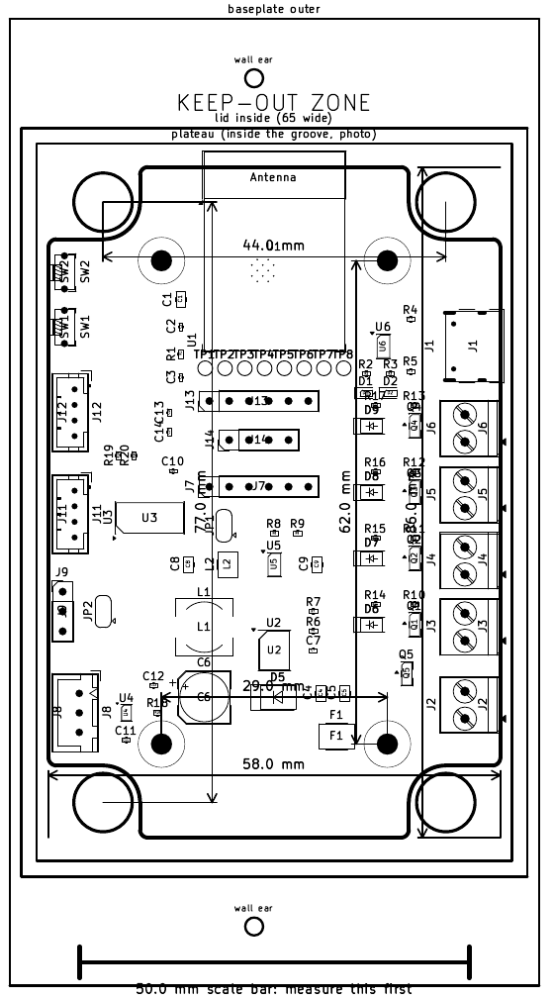
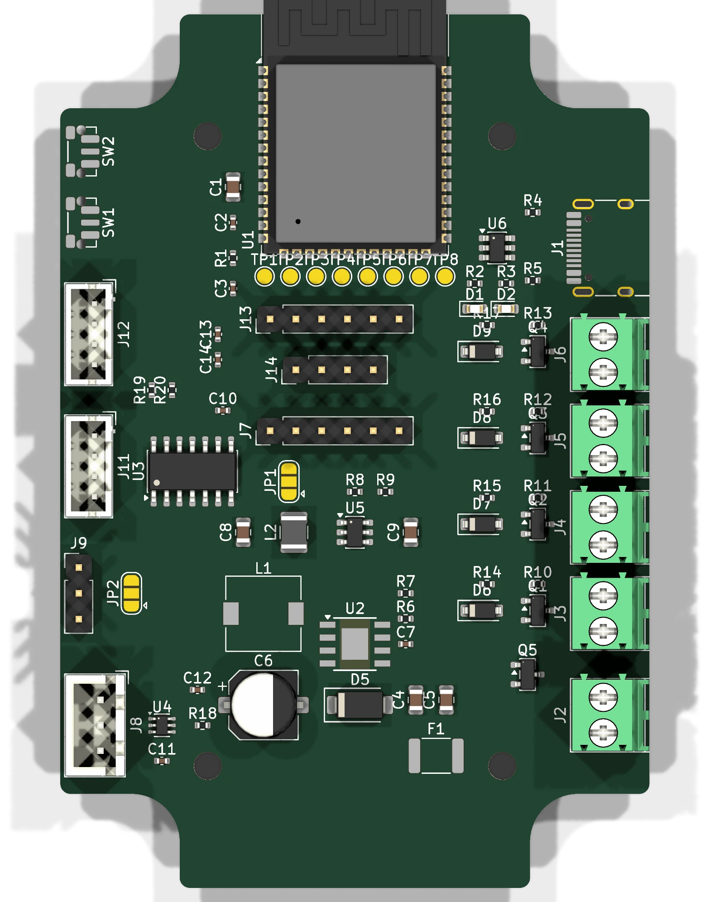
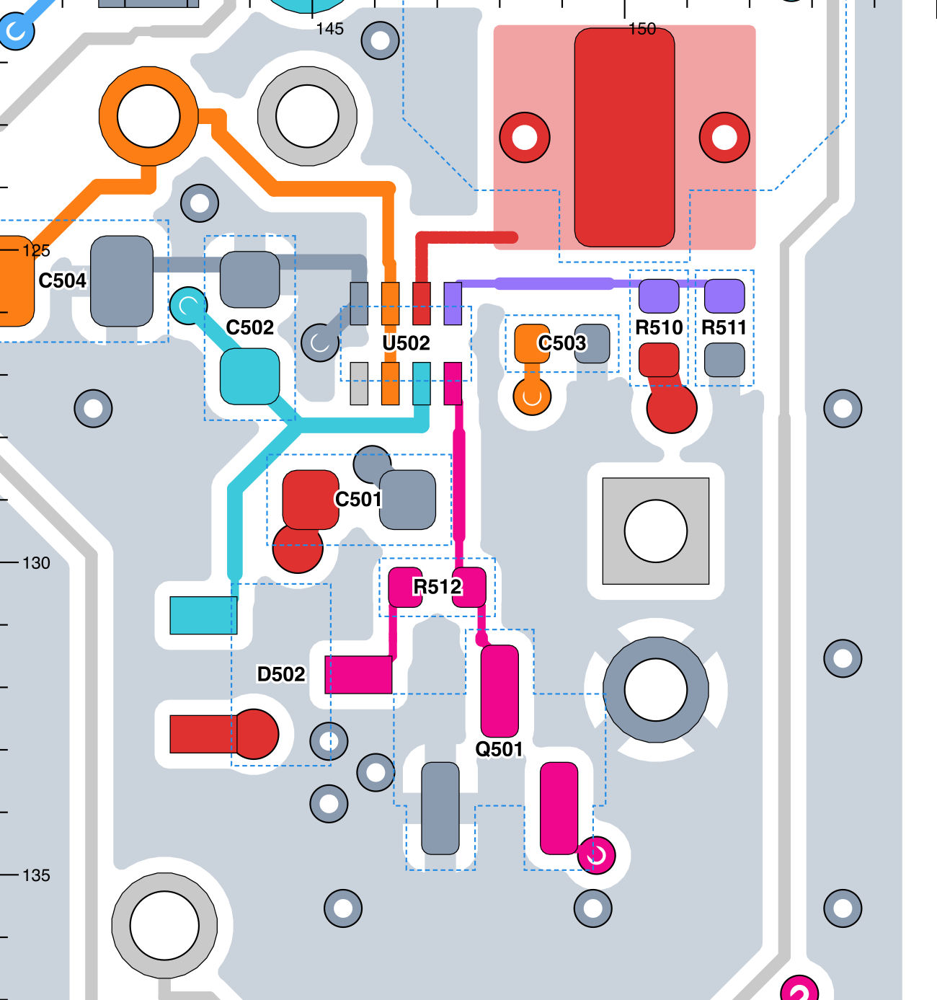
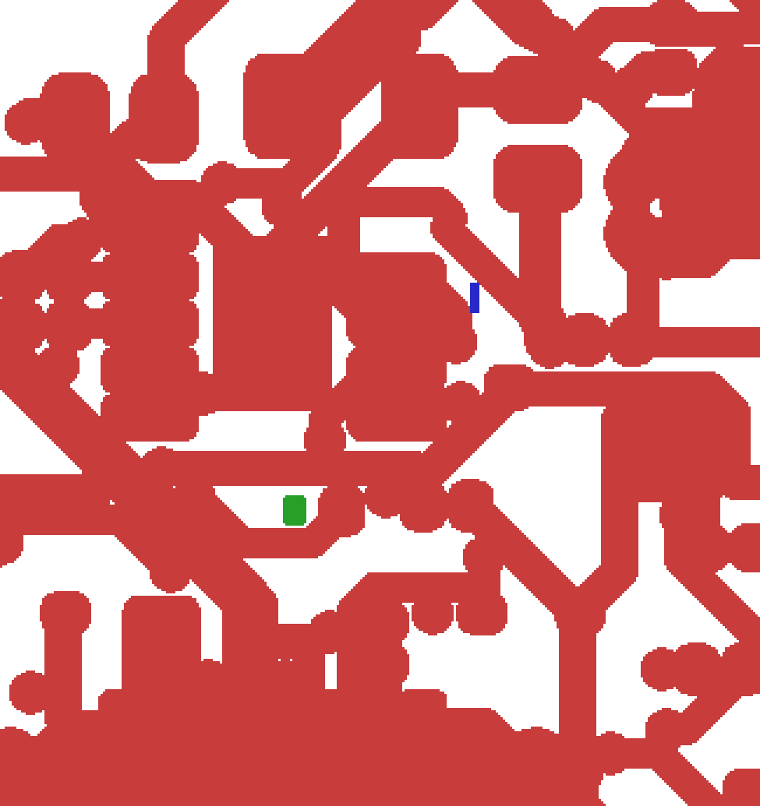
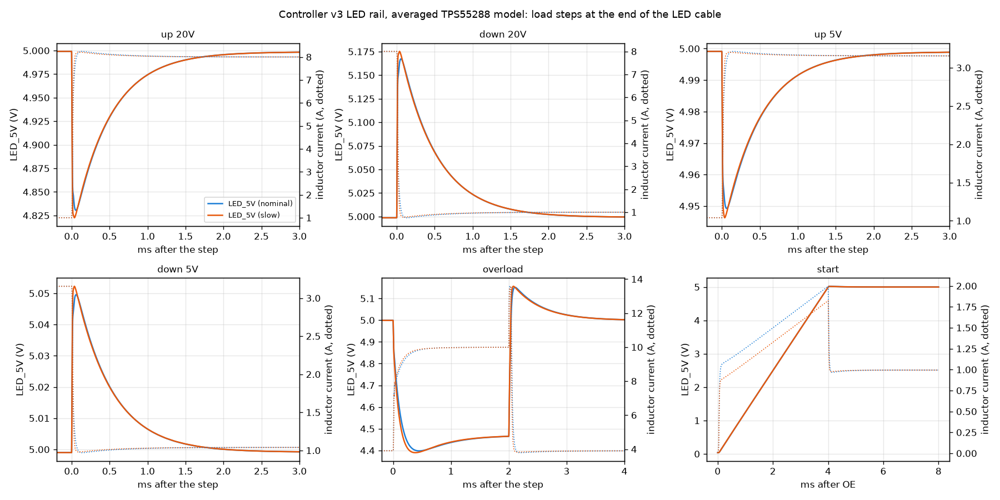
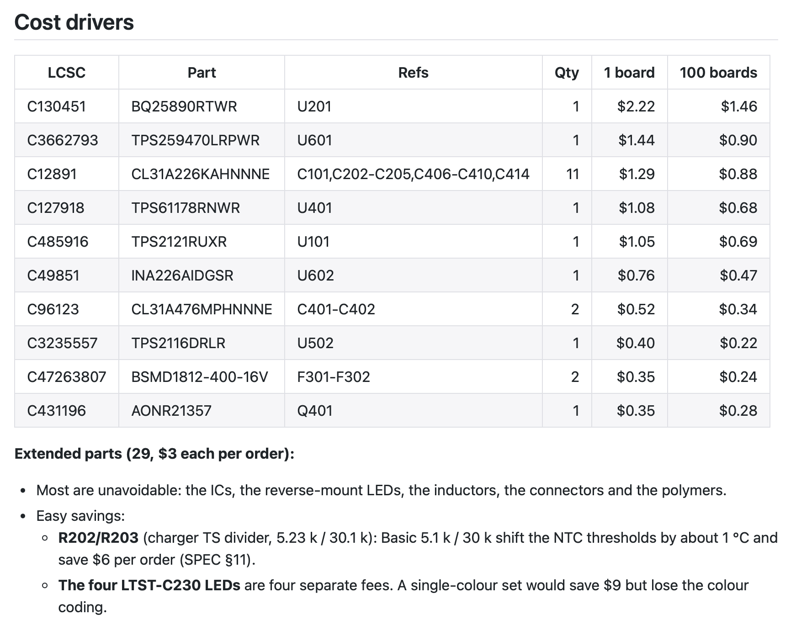

# pcb-kit

Shared tooling for the somebox KiCad hardware projects. It started as the scripts that every board ended up
copying (DRC summaries, fab files, previews, a schematic builder) and grew into a way of working with an agent on a
board: describe the design in text, check it with scripts, and look at pictures of it along the way.

The kit holds the engine; each project keeps its own data. Placement tables, net lists, power-stage geometry and
design notes stay in the board's repo and call `pcbkit`.

Three parts:

- **`pcbkit`**, a Python package and CLI: checks, release files, enclosure outlines, EasyEDA import, net views,
  simulation runs, a schematic builder for konnect.
- **`skills/`**, agent skills in SKILL.md form, used by Claude Code and pi.
- **`templates/`** and **`library/`**: the project skeleton, conventions and trusted parts.

## Using it from an agent

- **Claude Code:** `claude --plugin-dir /path-to/pcb-kit` or add this folder to a local marketplace; the skills in `skills/`
  are then invocable. A project can also symlink `skills/pcb-kit` into its own `.claude/skills/`.
- **pi:** `pi install /path-to/pcb-kit` (the `package.json` here declares the skills), or `pi --skill /path-to/pcb-kit/skills/pcb-kit`.
- **KiCad:** nothing to install; the commands drive `kicad-cli` and KiCad's Python, and konnect (the KiCad MCP server) is
  used from both agents and `pcbkit.schematic`.

## What it does

### Start or import a project

`pcbkit new` scaffolds a hardware repo: README, DESIGN, LAYOUT and PRODUCTION documents with status lines, an empty
KiCad project with library tables, `scripts/`, a bomi project and a first commit. `pcbkit import-easyeda` brings an
EasyEDA Std schematic and PCB across with symbols and footprints into the project library and runs ERC, DRC and
parity on the result. The esp32-ha-protoboard was converted this way, and esp32-s3-ha-node was started with `new`.

### Fit a board to a box

Measure the enclosure (drawing, calipers, or a photo against a ruler), write the numbers into an `enclosure.json`,
and `pcbkit outline` draws the board outline with notches around the lid bosses, the mounting holes with their
standoff rings, keep-outs, and the box's walls for reference. `--fit-check` exports a 1:1 PDF with dimension lines
and a scale bar to print, cut out and screw into the box. `--parts` adds the placed parts, for a last check of the
connectors against the walls.



### See how dense a board gets before drawing the schematic

A placement mock-up drops stock footprints for the proposed parts onto the outline, grouped by block, without nets.
A 3-D render then shows how full the board is, which edges the connectors need, and what the alternatives look
like, such as three terminal-block pitches. The esp32-s3-ha-node layout was settled over several rounds of this, before any schematic existed.



### Look at the copper

`pcbkit netview` draws one layer of a board region with every net in its own colour, pads labelled and courtyards
dashed. It is the fastest way to review a power stage against the datasheet's layout guidance, or to see which net
a stray pour belongs to.



When a check flags something small, a tight raster of the layer with the flagged items marked shows what it
actually refers to before anything gets edited:



### Check a board

`pcbkit drc`, `erc` and `nets` wrap `kicad-cli` and summarise by type, net and footprint. `pcbkit check` finds what
DRC doesn't: floating copper, stubs, loops, pours that reach a single pad, power pads fed only through thin track.
`pcbkit cleanup` removes duplicate and zero-length segments by editing the file text, because pcbnew's own
`Remove()` corrupts its bindings mid-run. Before an order, KiCadRoutingTools' checkers give a second opinion.

### Simulate the power path

`pcbkit spice` runs an ngspice deck with PSpice compatibility on, which vendor models need, and returns its
measurements. It reports a run as aborted when ngspice gives up, because a failed run still prints zeros. The
dodeca control board used this to size a boost converter's load-step margin and to find a supply-mux case where a
firmware test would have given the wrong answer, which changed the part. siebenuhr's controller
followed the same approach for its LED converter. The plot below shows its averaged TPS55288 buck-boost model, with
LED rail voltage and inductor current through load steps, an overload and start-up.



### Know what the board costs

bomi keeps the BOM in sync with the schematic and refreshes stock and price from JLC/LCSC; `pcbkit jlc` searches
the local parts cache for quick look-ups. A project's BOM.md lists the cost drivers, the Extended-part fees per
order, the cheap swaps, and any part whose stock is low enough to worry about.



### Reuse parts that worked

[library/PARTS.md](library/PARTS.md) collects the ICs and drivers that have been on built boards, with the circuit
notes that made them work and the ones that went wrong: level shifters that isolate an unpowered rail versus ones that
back-power it, LED drivers that need only a resistor, the USB-PD sink whose 5 V contract couldn't carry a clock's LEDs.
`pcbkit parts` lists the catalog with current stock and price from the parts cache and flags anything that has run low.
Two of the proven parts show zero stock in the 2026-09-29 cache, which is the reason to check when a design starts.

### Order it

`pcbkit previews` makes the schematic PDF, copper PNGs, a hand-assembly map, a 1:1 print and 3-D renders.
`pcbkit fab` writes the JLC Gerber zip, BOM and CPL with rotation corrections. `pcbkit panel` builds KiKit assembly
panels with rails, fiducials and tooling holes, and runs DRC on each.

## Skills

| Skill | Use it for |
| --- | --- |
| [pcb-kit](skills/pcb-kit/SKILL.md) | the command map, the project rules, KiCad Python gotchas |
| [visual-review](skills/visual-review/SKILL.md) | which picture answers which question, and how to read it before drawing conclusions |
| [enclosure-fit](skills/enclosure-fit/SKILL.md) | measuring a box, the outline JSON, the print-and-cut loop and what went wrong in it |
| [power-sim](skills/power-sim/SKILL.md) | one ngspice script per design question; averaged models when vendor models stall |
| [bom-cost](skills/bom-cost/SKILL.md) | the proven-parts catalog first, then bomi: stock checks, Extended-part fees, what goes into BOM.md |

[docs/CONVENTIONS.md](docs/CONVENTIONS.md) is the project layout and writing style they all assume: dated status
lines, numbered decisions, generated files that say what made them.

## Tools it builds on

| Tool | Role |
| --- | --- |
| KiCad 10 (`kicad-cli`, pcbnew Python) | the design files, DRC/ERC, exports, renders |
| konnect | KiCad MCP server; `pcbkit.schematic` writes schematic sheets through it, and its JLCPCB cache backs `pcbkit jlc` |
| bomi | BOM, stock, prices, datasheet summaries |
| ngspice 47 | power-path simulation (`brew install ngspice`) |
| KiKit | panels, pinned to a known commit by `pcbkit setup-kikit` |
| KiCadRoutingTools | routing on siebenuhr, and a second set of checkers before every order |
| librsvg, poppler, ImageMagick | SVG to PNG, PDF crops and merges |

## Install

```bash
uv tool install -e ~/src/pcb-kit     # gives you `pcbkit`
pcbkit info                          # confirms where KiCad is
pcbkit setup-kikit                   # only for panels: pins KiKit into ~/.local/share/pcbkit
pcbkit link                          # lets project scripts `import pcbkit` under KiCad's Python and python3
```

`link` writes one `pcbkit.pth` into the user site-packages of KiCad's Python and of the `python3` on PATH, so nothing
goes into an app bundle and it survives upgrades; `pcbkit link --remove` undoes it. Because `python3` can differ per
directory (asdf, direnv, venvs), project scripts also carry a four-line fallback to `~/src/pcb-kit` (or `PCBKIT_ROOT`);
see docs/CONVENTIONS.md.

Two interpreters are involved. `pcbkit` runs in uv's Python; the commands that need `pcbnew` re-execute themselves
under KiCad's bundled Python (3.9 on macOS), so the package code stays 3.9-compatible and dependency-free. Set
`PCBKIT_KICAD_APP` if KiCad is not at `/Applications/KiCad/KiCad.app`. Previews need `rsvg-convert` (librsvg),
`pdfunite` (poppler) and optionally `magick` (ImageMagick); `pcbkit spice` needs `ngspice`.

## Commands

| Command | What it does |
| --- | --- |
| `pcbkit drc BOARD [--refill] [--save] [--full]` | DRC through kicad-cli: counts by type, every error, unconnected items by net and footprint. `--save` refills and writes the board back, which is how the projects keep their boards filled. Exit 1 on errors or unconnected items |
| `pcbkit erc SCH` | ERC summary, exit 1 on errors |
| `pcbkit nets SCH [NET ...]` | net sizes and members; `pcbkit.checks.netlist.Netlist` is the base for a project's topology assertions |
| `pcbkit check BOARD` | what DRC doesn't flag: floating copper, stubs with their full length, loops, pours reaching one pad, power pads fed only through thin track |
| `pcbkit cleanup BOARD [--dry-run]` | duplicate, zero-length and covered segments removed, collinear runs merged; edits the file text by uuid |
| `pcbkit previews BOARD OUT` | schematic PDF, copper PNGs front and back, hand-assembly map, 1:1 printable PDF, plane views on 4-layer boards, 3-D renders |
| `pcbkit print BOARD OUT.pdf` | the 1:1 printable PDF alone |
| `pcbkit fab BOARD OUT` | JLC Gerber zip, BOM and CPL (front-only and both-sides variants), rotations corrected from the kicad-jlcpcb-tools table |
| `pcbkit panel BOARD OUT [--style vcut\|mousebite\|both] [--rows 3] [--previews DIR]` | KiKit assembly panels with rails, tooling holes, fiducials, order-number placeholder, unique per-copy references; DRC on each |
| `pcbkit jlc --lcsc C25744` | SQL search over konnect's JLCPCB parts cache |
| `pcbkit parts [TEXT] [--low N]` | the proven-parts catalog (library/PARTS.md) with current stock and price; flags low stock |
| `pcbkit netview BOARD OUT.svg X0 Y0 X1 Y1 [--layer] [--png]` | a region of one layer coloured by net, for reviewing power stages |
| `pcbkit spice DECK.cir [--vendor DIR] [--gear-retry] [--keep DIR]` | ngspice with PSpice compatibility in a scratch directory; prints `.meas` values and `wrdata` files, exit 1 when the run aborted |
| `pcbkit new DIR --board NAME [--title ..] [--description ..]` | scaffold a project: README/DESIGN/LAYOUT/PRODUCTION from the templates, `boards/NAME/` empty KiCad project with lib tables, `lib/`, `scripts/` (previews, fab, builder glue), bomi, first git commit |
| `pcbkit outline BOARD enclosure.json [--fit-check PDF] [--parts]` | board outline (rounded, notched or cut around bosses), NPTH mounting holes with standoff courtyards, keep-out rule areas over bosses, reference geometry and notes, from a JSON measured off the enclosure; rerunnable. `--fit-check` adds the 1:1 print, `--parts` the placed parts on it |
| `pcbkit import-easyeda SCH.json PCB.json boards/<b> --name <b> --lib lib --lib-name <project> [--pin REF:NAME=NUM]` | EasyEDA Std exports to a linked KiCad project: converted schematic (every sheet; net ports and labels as global labels), symbols and footprints into `lib/`, PCB nets renamed, importer fixes, ERC/DRC/parity run |

Library use from a project script:

```python
from pcbkit import schematic as sch          # schematic sheets from Python data, through konnect
from pcbkit.konnect import Konnect           # the MCP client itself
from pcbkit.parts import resistor, capacitor # stock R/C with LCSC numbers; parts.catalog() reads library/PARTS.md
from pcbkit.silk import Placer               # silkscreen label placement around an anchor box
from pcbkit.route import complete_nets      # maze router, plane vias, neck-down, track-end audit (KiCad's Python)
from pcbkit.checks.netlist import Netlist    # netlist topology assertions
from pcbkit.spice import run                 # ngspice deck -> measurements, wrdata files, aborted flag
```

## Repository layout

```
pcbkit/            the package (checks/, release/, schematic.py, konnect.py, parts.py, silk.py, route.py, netview.py, spice.py, import_easyeda.py, mech.py, new_project.py)
pcbkit/data/       jlc/corrections.csv (rotations), panel/ (KiKit presets, tabs plugin, post script), templates/blank.kicad_pcb
skills/            SKILL.md folders, one per workflow (Claude Code plugin manifest in .claude-plugin/, pi manifest in package.json)
templates/project  README/DESIGN/LAYOUT/PRODUCTION skeletons and .gitignore for a new hardware repo
library/           PARTS.md (parts that worked, with notes); shared symbols, footprints and blocks as they are harvested
docs/              CONVENTIONS.md (how a project is laid out and documented), HARVEST.md (where each piece came from), images/
```

## Status

Harvested on 2026-10-10 from the rp2354-messages-sign, siebenuhr controller-v2, rgb-spotlight and dodeca-v2-hardware
repos; see [docs/HARVEST.md](docs/HARVEST.md) for where each piece came from and what is still in the projects.
siebenuhr, the message sign and the spotlight use the kit; dodeca still runs its own tools until v1.3 is ordered.
Since then: EasyEDA import, enclosure outlines and fit-check prints (2026-10-10/11), `pcbkit spice` (2026-10-11,
from the dodeca v1.3 simulations) and the proven-parts catalog (2026-10-11).
